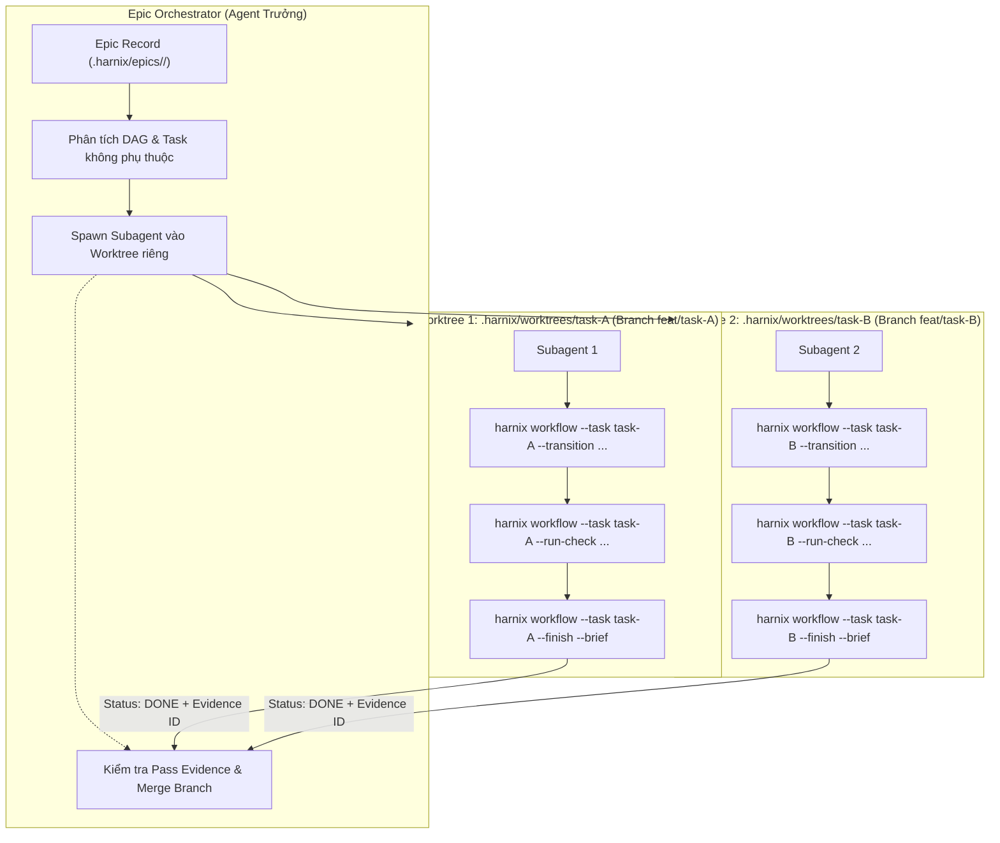

# Khảo sát thực tế: Kiến trúc Multi-Agent Parallelism và Mô hình Git Worktree Isolation cho Epic

Tài liệu này ghi nhận kết quả khảo sát thực tế (Research & Benchmarking) về cách các hệ thống coding agent hàng đầu thế giới triển khai chạy song song nhiều task/agent, từ đó định hình kiến trúc chuẩn cho Harnix Epic.

---

## 1. Bối cảnh & Thách thức cốt lõi

Khi một Epic có nhiều member tasks (như refactor 3 module độc lập, viết test cho 4 controller, hoặc triển khai đồng thời 2 API clients), việc chạy tuần tự từng task làm kéo dài thời gian hoàn thành. Tuy nhiên, việc kích hoạt nhiều agent chạy song song trên một codebase gặp phải các xung đột nghiêm trọng:

1. **Xung đột con trỏ tác vụ (.active Collision)**:
   Mặc định Harnix quản lý 1 active task thông qua con trỏ `.harnix/tasks/.active`. Nếu nhiều agent cùng gọi các lệnh vòng đời (`transition`, `run-check`, `finish`), con trỏ bị ghi đè chéo làm sai lệch trạng thái của các agent.
2. **Race Condition & Đè mã nguồn (Working Tree Contention)**:
   Nếu 2 subagents cùng sửa mã trong cùng một thư mục làm việc, file sửa đổi của agent này sẽ đè lên agent kia hoặc gây conflict khi format/commit.
3. **Lệch băm kiểm thử (inputDigest Invalidation)**:
   Cơ chế `inputDigest` của Harnix v3 tính toán mã băm trên các file đầu vào của `validationPlan`. Nếu Agent A sửa đổi code trong khi Agent B đang chạy kiểm thử, bằng chứng của Agent B lập tức bị đánh dấu là `stale`, không thể hoàn thành task.

---

## 2. Đối sánh các mô hình thực tế trong ngành

| Tiêu chí | 1. Shared Directory + File Lock (ChatDev / MetaGPT v1) | 2. Hermetic Containers (SWE-bench / Devin) | 3. Git Worktree Isolation (Claude Code / Antigravity / Cursor) |
|---|---|---|---|
| **Cơ chế cách ly** | Cùng 1 thư mục, dùng lock hoặc phân quyền theo đường dẫn file | Mỗi agent chạy trong 1 Docker container / VM riêng biệt | Mỗi agent chạy trong 1 Git Worktree gắn với branch riêng |
| **Mức độ an toàn** | Thấp: Dễ race condition, test runner đụng port/database, digest stale liên tục | Tuyệt đối: Độc lập hoàn toàn từ OS, network tới filesystem | Rất cao: Mã nguồn, git branch và file test được cách ly sạch sẽ |
| **Chi phí tài nguyên** | Nhẹ nhất (0 overhead) | Rất nặng: Tốn GB RAM, CPU, yêu cầu Docker daemon và thời gian boot container | Rất nhẹ: Tận dụng cơ chế link object của Git, tạo worktree chỉ mất vài mili-giây |
| **Khả năng merge** | Khó khăn vì thay đổi bị trộn lẫn trong working tree | Cần xuất git patch hoặc git push từ container về host | Tự nhiên qua Git: Mỗi task là 1 branch, Orchestrator merge qua `git merge` |
| **Phù hợp với Harnix** | ❌ Không khả thi vì làm hỏng cơ chế `inputDigest` | ❌ Vi phạm ranh giới Harnix (không daemon, không container) | ✅ **Lựa chọn tối ưu nhất cho Harnix** |

---

## 3. Kiến trúc chuẩn: Git Worktree Isolation & Task Binding cho Harnix

Mô hình được áp dụng cho Harnix gồm 3 thành phần cốt lõi:



### 3.1. Tầng Task Binding (--task flag cho toàn bộ vòng đời)
* Bỏ qua phụ thuộc vào con trỏ duy nhất `.harnix/tasks/.active`.
* Mọi lệnh kiểm tra và thay đổi trạng thái (`--transition`, `--run-check`, `--evidence`, `--criterion`, `--finish`) khi nhận tham số `--task <task-id>` sẽ thao tác trực tiếp và nguyên tử trên `.harnix/tasks/<task-id>/task.json`.
* Điều này cho phép $N$ subagents thực thi song song mà không tranh chấp trạng thái.

### 3.2. Tầng Không gian làm việc (Git Worktree)
* Mỗi subagent làm việc trong một worktree riêng biệt được tạo tự động:
  ```bash
  git worktree add .harnix/worktrees/<task-id> -b feat/<task-id> <base-branch>
  ```
* Sau khi subagent hoàn thành và toàn bộ checks pass, Agent trưởng (Orchestrator):
  1. Xác minh bằng chứng pass trên task record.
  2. Merge branch `feat/<task-id>` vào nhánh mục tiêu.
  3. Dọn dẹp worktree:
     ```bash
     git worktree remove .harnix/worktrees/<task-id>
     ```

### 3.3. Tầng Điều phối (Epic Orchestrator)
* Agent trưởng đọc danh sách `members` trong `epic.json`.
* Nhận diện các task có tập `inputs` không giao thoa và không có phụ thuộc logic (`dependsOn: []`).
* Kích hoạt các subagent song song (thông qua công cụ native của host platform như `invoke_subagent` với `Workspace: 'branch'` trong Antigravity/Cursor/Claude Code).
* Thu nhận báo cáo theo giao thức chuẩn `scouting-isolation.md` và đồng bộ tiến độ vào `epic.md`.

---

## 4. Kết luận & Quyết định kiến trúc

1. **Chính thức áp dụng mô hình Git Worktree Isolation** cho tính năng thực thi song song của Harnix Epic.
2. Bổ sung **Task 5** vào Epic để triển khai:
   * Mở rộng cờ `--task <id>` cho toàn bộ các lệnh vòng đời task.
   * Xây dựng tài liệu kỹ thuật & skill hướng dẫn điều phối Multi-Agent song song với Git Worktree.

---

## 5. Nhật ký vấn đề phát sinh trong thực tế & Hạng mục cải tiến cho Task 8

Trong quá trình thực thi Task 1 (`20261018-175353-encoding-zero-pipe-and-base64`), đã phát hiện các điểm nghẽn và ghi nhận bổ sung vào Task 8 (`20261018-175400-dx-error-diagnostics-and-epic-decoupling`):

1. **Độ cứng nhắc của Regex kiểm tra Version trong Test**:
   - Các test `test/workflow/provenance.test.ts`, `test/unit/skills/catalog.test.ts`, `test/unit/skills/technique-skills.test.ts` hardcode regex `^2\.(?:9|10)\.`. Khi bump version epic `2.11.0-dev.1`, các test này gãy hàng loạt dù code không có lỗi.
   - *Hướng cải tiến Task 8:* Chuẩn hóa hàm kiểm tra semver hoặc regex linh hoạt để không cản trở việc phát triển các series phiên bản tiếp theo.

2. **Xung đột Relative Links trong cơ chế Dual-Write Flat File của Epic**:
   - `renderEpicMarkdown` khi ghi file flat `.harnix/epics/<id>.md` sinh link `./research.md` bị gãy (broken relative link) do file thực tế nằm ở `.harnix/epics/<id>/research.md`.
   - *Đã khắc phục tạm thời:* Tự động biến đổi prefix link `(./` thành `(./${epicId}/` cho file flat.
   - *Hướng xử lý triệt để:* Task 7 sẽ hoàn tất loại bỏ dual-write flat file và chuyển hẳn sang pure folder storage.

3. **Chẩn đoán lỗi khi thực thi kiểm thử dạng background**:
   - Khi chạy lệnh dài trong background (`WaitMsBeforeAsync`), nếu fail cần có cơ chế tóm tắt tail lỗi nhanh chóng và thân thiện hơn cho Agent.

4. **Hạn chế của `harnix workflow --criterion <id1>,<id2> --met` đối với danh sách phân tách dấu phẩy**:
   - Lệnh `--criterion` hiện tại xử lý `<id>` đơn lẻ; khi truyền chuỗi danh sách có dấu phẩy (`ac-1,ac-2`), parser chỉ khớp đúng một ID đầu tiên hoặc không phân rã token làm các tiêu chí sau vẫn ở trạng thái pending.
   - *Hướng cải tiến Task 8:* Cho phép `--criterion` chấp nhận danh sách ID phân tách bằng dấu phẩy hoặc lặp lại nhiều cờ `--criterion` để cập nhật nguyên tử đồng thời nhiều tiêu chí.

5. **Bổ sung cờ `--brief` cho `harnix resume`**:
   - Lệnh `harnix resume <id>` hiện báo lỗi `unknown option '--brief'` khi truyền cờ `--brief`.
   - *Hướng cải tiến Task 8:* Chuẩn hóa cờ `--brief` cho `harnix resume` để đồng bộ với nguyên tắc Token Economy (Rule 10).

6. **Chẩn đoán và hướng dẫn thông báo khi thay thế check (`--replace-check`)**:
   - Khi một check thất bại nhưng lỗi thuộc về file hướng dẫn ngoài lề (như format/guidance test) và đã được sửa chữa, việc chạy lại lệnh `--run-check <id>` vẫn được phép nếu số lần fail chưa vượt quá giới hạn retry; tuy nhiên nếu thử dùng `--replace-check` mà giữ nguyên `command` và `inputs` thì CLI sẽ từ chối ("must differ from the retired check").
   - *Hướng cải tiến Task 8:* Bổ sung thông báo giải thích rõ ràng hơn về điều kiện retry vs replace check khi gặp lỗi.

7. **Gợi ý lệnh chính xác khi chuyển trạng thái từ checkpoint replan**:
   - Khi ở checkpoint `replan`, nếu agent chuyển trạng thái sang `in_progress/implementing` hoặc `in_progress/ready`, CLI từ chối với thông báo trừu tượng.
   - *Hướng cải tiến Task 8:* Thông báo lỗi cần hướng dẫn trực tiếp câu lệnh hợp lệ: `harnix workflow --transition ready/ready --reviewed --brief`.

8. **Chuẩn hóa thuộc tính `cwd` trong `obligationsChanged`**:
   - Khi so sánh thay đổi nghĩa vụ hợp đồng kiểm thử, `cwd: "."` và `cwd: undefined` cần được coi là tương đương nhau để tránh báo nhầm vi phạm đóng băng hợp đồng.
   - *Hướng cải tiến Task 8:* Chuẩn hóa normalize check cwd trong so sánh nghĩa vụ kiểm thử.


