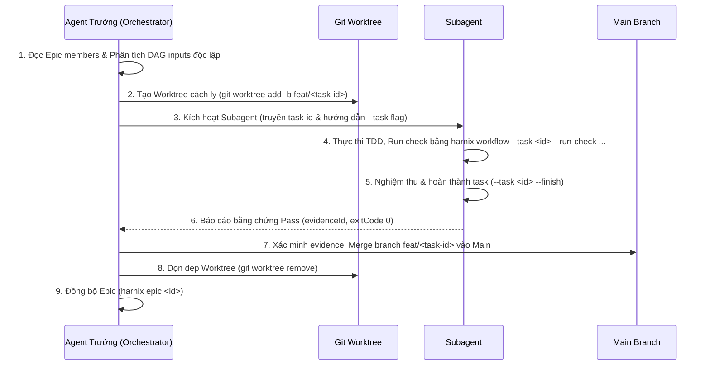

# Đặc tả kỹ thuật: Điều phối Multi-Agent song song và Hòa giải xung đột Git Worktree

**Mã Epic**: `20261018-175353-dx-robustness-and-php-resilience`  
**Tác giả**: Harnix Agent Core  
**Trạng thái**: Draft / Approved for Orchestration  

---

## 1. Giới thiệu & Ranh giới kỹ thuật

Khi thực hiện một Epic lớn gồm nhiều thành phần độc lập (như refactor nhiều module, triển khai song song client hoặc viết test), việc điều phối song song các Coding Agent (Antigravity, Claude Code, Cursor, Kiro, Codex, OpenCode) giúp tăng tốc độ phân phối gấp nhiều lần.

### Ranh giới cốt lõi (Non-negotiable product boundaries)
- **Không daemon, không service chạy ngầm**: Harnix không cung cấp worker daemon hay network scheduler. Việc spawn tiến trình/agent con thuộc trách nhiệm của công cụ điều phối ngoài hoặc Agent Trưởng (thông qua `invoke_subagent` với `Workspace: 'branch'` trong Antigravity/Cursor/Claude Code).
- **Không tự động mutate Git từ CLI runtime**: Harnix CLI không tự động gọi `git worktree add`, `git commit` hay `git merge`. Toàn bộ thao tác tạo worktree, checkout branch, commit và merge do Agent Trưởng hoặc người dùng chỉ huy rõ ràng.
- **Tính bất biến và an toàn của Task State**: Mỗi task thành viên trong Epic phải có khả năng thực thi độc lập mà không làm sai lệch con trỏ tác vụ (`.active`) hoặc làm stale `inputDigest` của các task khác.

---

## 2. Phân tích Xung đột khi Merge Branch Worktree

Khi các subagents thực thi trên các branch worktree riêng biệt (`feat/<task-id>`) và hoàn thành, Agent Trưởng sẽ merge các branch này vào branch tích hợp chính (ví dụ `v2` hoặc `develop`). Các điểm xung đột dữ liệu tiềm tàng gồm:

### 2.1. Con trỏ active task (`.harnix/tasks/.active`)
- **Vấn đề**: Subagent A trỏ `.active` tới Task A, Subagent B trỏ tới Task B. Khi merge, Git sẽ báo conflict trên file `.active`.
- **Giải pháp chuẩn hóa**:
  1. Các subagent trong worktree bắt buộc sử dụng cờ `--task <task-id>` (được hỗ trợ ở Task 5b: `20261018-175358-multi-agent-worktree-orchestration`) trong mọi thao tác vòng đời (`--transition`, `--run-check`, `--criterion`, `--finish`), không làm thay đổi file `.active`.
  2. Trước khi commit branch của task, subagent hoặc Orchestrator gọi `harnix pause` để xóa bỏ file `.active` trong worktree đó, bảo đảm branch worktree không chứa thay đổi trên `.active`.
  3. Khuyến nghị cấu hình `.gitignore` hoặc Git merge driver ignore đối với `.harnix/tasks/.active` trong môi trường worktree.

### 2.2. Tài liệu Markdown của Epic (`.harnix/epics/<epic-id>/epic.md`)
- **Vấn đề**: `epic.md` là tài liệu dẫn xuất tự sinh (derived artifact). Khi mỗi subagent finish một task, bảng tiến độ và checklist thành viên được sinh lại. Nếu cả hai subagent cùng commit `epic.md`, việc merge 2 nhánh sẽ gây conflict văn bản.
- **Giải pháp chuẩn hóa**:
  1. Trong branch worktree của subagent, **không commit `epic.md`**. File này là derived và Agent Trưởng ở worktree chính sẽ tái tạo tự động sau khi merge xong bằng lệnh `harnix epic <epic-id>`.
  2. Subagent chỉ commit thư mục task của chính nó: `.harnix/tasks/<task-id>/**` cùng các file mã nguồn/test thuộc phạm vi task.

### 2.3. Bảng ghi nhiệm vụ (`.harnix/tasks/<task-id>/task.json`)
- **Vấn đề**: Tranh chấp dữ liệu task.
- **Giải pháp chuẩn hóa**:
  - Mỗi task nằm trong thư mục riêng biệt duy nhất `.harnix/tasks/<task-id>/`. Git merge hoàn toàn an toàn (clean 3-way merge) vì hai subagent khác nhau sửa đổi hai thư mục tách biệt, không bao giờ xảy ra conflict trên `task.json` hay `review.md`.

---

## 3. Kiến trúc Cờ `--task <id>` (Task Binding)

Để giải phóng subagent khỏi sự phụ thuộc vào file `.active`:

1. **Phạm vi hỗ trợ cờ `--task <task-id>`**:
   Toàn bộ các action của lệnh `harnix workflow` cần chấp nhận tham số `--task <id>` (hoặc `-t <id>`):
   - `--transition <status/checkpoint>`
   - `--run-check <check-id> -- <cmd>`
   - `--run-checks`
   - `--set-check <check-id>`
   - `--replace-check <check-id>`
   - `--criterion <id>`
   - `--add-criterion`
   - `--set-criterion`
   - `--finish`
   - `--cancel`
   - `--save`

2. **Cơ chế hoạt động**:
   - Khi có `--task <id>`, CLI bỏ qua bước đọc `.harnix/tasks/.active` và nạp trực tiếp TaskRecord từ `.harnix/tasks/<id>/task.json`.
   - Mọi cập nhật trạng thái chỉ ghi vào thư mục của task đó và không đụng tới `.active`.
   - Tính toán `inputDigest` được giới hạn chặt chẽ theo các `inputs` glob của task, không bị ảnh hưởng bởi các file ngoài phạm vi.

---

## 4. Giao thức Điều phối Multi-Agent dành cho Agent Trưởng (Orchestrator Protocol)

Agent Trưởng đóng vai trò điều phối viên theo quy trình 6 bước:



### Chi tiết các bước:
1. **Phân tích DAG & Độc lập**:
   - Chỉ kích hoạt song song các task có `inputs` không giao thoa và không có phụ thuộc lẫn nhau.
   - Nếu hai task cùng sửa một file (ví dụ cùng sửa `src/core/workflow/save.ts`), chúng phải được lên lịch tuần tự.
2. **Khởi tạo Worktree**:
   ```bash
   git worktree add .harnix/worktrees/<task-id> -b feat/<task-id> HEAD
   ```
3. **Chỉ đạo Subagent**:
   - Subagent làm việc hoàn toàn bên trong `.harnix/worktrees/<task-id>`.
   - Mọi lệnh CLI đều dùng cờ `--task <task-id>`:
     ```bash
     harnix workflow --task <task-id> --transition in_progress/implementing --brief
     harnix workflow --task <task-id> --run-check <check-id> --brief -- <test-cmd>
     harnix workflow --task <task-id> --criterion ac-1 --met --brief
     harnix workflow --task <task-id> --transition verifying/finishing --brief
     harnix workflow --task <task-id> --finish --brief
     ```
4. **Hòa giải & Merge**:
   - Agent Trưởng kiểm tra trạng thái task qua `harnix status --summary` hoặc kiểm tra `task.json`.
   - Thực hiện merge branch của task vào nhánh chính:
     ```bash
     git merge --no-ff feat/<task-id> -m "feat(task): hoàn thành <task-id>"
     git branch -d feat/<task-id>
     git worktree remove .harnix/worktrees/<task-id>
     ```
5. **Cập nhật Epic**:
   - Chạy `harnix epic <epic-id>` từ nhánh chính để tự động làm mới `epic.md`.

---

## 5. Kế hoạch triển khai kỹ thuật (Chuyển tiếp Task 5b)

Đặc tả này là cơ sở trực tiếp cho **Task 5b** (`20261018-175358-multi-agent-worktree-orchestration`):
1. Cập nhật `src/commands/workflow-command.ts` và các module core trong `src/core/workflow/` để tiếp nhận và truyền `taskId` từ option `--task <id>`.
2. Tạo skill mẫu hoặc tài liệu hướng dẫn trong `src/skills/harnix-plan/references/` về quy trình Git Worktree Isolation.
3. Bổ sung test kiểm thử độc lập cho việc cập nhật task qua cờ `--task` mà không cần file `.active`.
